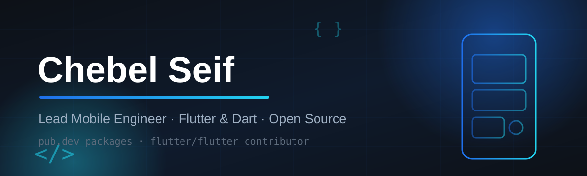

  

  

    <strong>Lead Mobile Engineer</strong> · Flutter &amp; Dart · Open-source packages · Framework contributions
  

  

    
    
    
    
    
    
    
  

I design and ship mobile products with **Flutter**, and I build the tooling that other developers rely on. My day-to-day work sits at the intersection of **mobile architecture, state management, and developer experience** at [@THODZ-SOLUTIONS](https://github.com/THODZ-SOLUTIONS).

Outside product work I maintain **open-source packages on [pub.dev](https://pub.dev/publishers/thodz.com/packages)** that each solve one concrete problem — date conversion, UI state persistence, form-draft recovery, and mobile project diagnostics — and I contribute fixes to the frameworks I use every day, including **[`flutter/flutter`](https://github.com/flutter/flutter/pull/197215)** and **[`dart_pdf`](https://github.com/DavBfr/dart_pdf/pulls)**.

---

## 📦 Open-source packages

> All packages are published under the **[thodz.com](https://pub.dev/publishers/thodz.com/packages)** publisher on pub.dev.

<table>
  <tr>
    <td width="50%" valign="top">
      <h3>🌙 <a href="https://github.com/phantome001/hijri_toolkit">hijri_toolkit</a></h3>
      <strong>Gregorian ↔ Hijri conversion, done right.</strong>
      
Convert between Gregorian and Hijri dates and format them in Arabic or English, with pure Dart and Flutter support.

      
      
📦 <a href="https://pub.dev/packages/hijri_toolkit">pub.dev/packages/hijri_toolkit</a>

      
Pure Dart · Calendar math · RTL-ready formatting

    </td>
    <td width="50%" valign="top">
      <h3>🧠 <a href="https://github.com/phantome001/ui_memory">ui_memory</a></h3>
      <strong>Remember your UI across rebuilds and restarts.</strong>
      
Persists Flutter UI state so users never lose their place — no plugins, no native code, pure Flutter.

      
      
📦 <a href="https://pub.dev/packages/ui_memory">pub.dev/packages/ui_memory</a>

      
State restoration · Pure Flutter · No plugins

    </td>
  </tr>
  <tr>
    <td width="50%" valign="top">
      <h3>📝 <a href="https://github.com/phantome001/form_draft">form_draft</a></h3>
      <strong>Never lose what the user typed.</strong>
      
Automatically saves and restores Flutter form drafts, so an accidental navigation or crash never wipes an application.

      
      
📦 <a href="https://pub.dev/packages/form_draft">pub.dev/packages/form_draft</a>

      
Auto-save · Recovery · Pure Flutter

    </td>
    <td width="50%" valign="top">
      <h3>🩺 <a href="https://github.com/phantome001/flutter_mobile_doctor">flutter_mobile_doctor</a></h3>
      <strong>Diagnose Flutter mobile projects from the terminal.</strong>
      
A pure Dart CLI that detects the common Android and iOS configuration mistakes that break builds and releases.

      
      
📦 <a href="https://pub.dev/packages/flutter_mobile_doctor">pub.dev/packages/flutter_mobile_doctor</a>

      
Pure Dart CLI · Build diagnostics · CI-friendly

    </td>
  </tr>
</table>

---

## 🧩 Framework contributions

Pull requests currently under review in the frameworks I depend on:

| Repository | PR | What it fixes |
|---|---|---|
| [`flutter/flutter`](https://github.com/flutter/flutter/pull/197215) | [#197215](https://github.com/flutter/flutter/pull/197215) | Optional default `duration` and `curve` for `PageController.animateToPage`, `nextPage`, `previousPage` (fixes [#37568](https://github.com/flutter/flutter/issues/37568)) |
| [`DavBfr/dart_pdf`](https://github.com/DavBfr/dart_pdf/pull/2033) | [#2033](https://github.com/DavBfr/dart_pdf/pull/2033) | Correct table borders in right-to-left layouts |
| [`DavBfr/dart_pdf`](https://github.com/DavBfr/dart_pdf/pull/2034) | [#2034](https://github.com/DavBfr/dart_pdf/pull/2034) | Decoration fill alpha ignored in painted output |
| [`DavBfr/dart_pdf`](https://github.com/DavBfr/dart_pdf/pull/2035) | [#2035](https://github.com/DavBfr/dart_pdf/pull/2035) | Isolated Arabic letter aliases in font cmap (fixes [#2000](https://github.com/DavBfr/dart_pdf/issues/2000)) |

---

## 🛠️ Engineering toolkit

<table>
  <tr>
    <td width="50%" valign="top">
      <h3>💻 Languages &amp; frameworks</h3>
      

        
        
        
        
        
        
      

      
Flutter · Dart · JavaScript · TypeScript · Python · React

    </td>
    <td width="50%" valign="top">
      <h3>☁️ Platform &amp; services</h3>
      

        
        
        
        
      

      
<b>Firebase:</b> Auth · FCM · Firestore · Crashlytics · Analytics · Remote Config

      
<b>Supabase:</b> Auth · Postgres · Storage · Realtime · Edge Functions

      
<b>Mobile platforms:</b> Google Play · App Store · Deep linking · Push notifications

    </td>
  </tr>
  <tr>
    <td colspan="2" valign="top">
      <h3>⚙️ Architecture &amp; delivery</h3>
      

        
        
        
        
      

      
Clean architecture · State management · Widget &amp; unit testing · CI/CD · REST APIs · SaaS &amp; multi-tenant systems · Release engineering

    </td>
  </tr>
</table>

---

## 📊 GitHub activity

  
  

---

## 📝 Writing

I document the problems I solve — package releases, framework contributions, and mobile engineering notes — on [**Medium**](https://medium.com/@cheddine27) and [**cseifeddine.tech**](https://cseifeddine.tech/).

**Latest article:** [**I Contributed to flutter/flutter — Here's How I Did It**](https://medium.com/@cheddine27/i-contributed-to-flutter-flutter-heres-how-i-did-it-e63cdec51134) — how a six-year-old `PageController` issue became my first framework PR.

---

  <strong>SOLVE ONE REAL PROBLEM · TEST IT · SHIP IT</strong>
    
  

